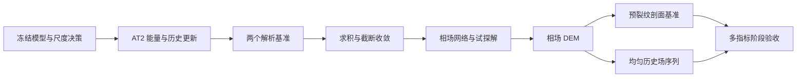

# 003：Griffith 2D 独立 AT2 相场与历史场基准

| 属性 | 内容 |
| --- | --- |
| 项目 | `griffith2d` |
| 状态 | 已完成 |
| 阶段 | 阶段 3：独立 AT2 相场问题与不可逆性检查 |
| 理论规范 | [`../../tutorials/pinn-dem-phase-field-derivation.md`](../../tutorials/pinn-dem-phase-field-derivation.md) 第 7–8 节 |
| 模块规范 | [`../../griffith2d/README.md`](../../griffith2d/README.md) |
| 前置计划 | [`001`](001-griffith2d-physics-core.md)、[`002`](002-griffith2d-quadrature-elastic-dem.md)，均已完成 |
| 后续计划 | 位移—相场交替耦合与准静态载荷步（待编号） |

## 1. 阶段目标

在不耦合位移网络、不模拟裂纹扩展的条件下，建立可独立验证的 AT2 相场计算链：

1. 实现 AT2 局部项与梯度项；
2. 实现冻结历史场下的相场代理能量与强形式残差；
3. 建立历史场的单调更新和尺度转换；
4. 用解析解验证相场能量、自然边界、长度尺度和驱动力；
5. 用确定性 DEM 求解一维预裂纹剖面与均匀历史场问题；
6. 明确区分“历史场不减”与“相场严格不可逆”。

本阶段的目的，是在进入非凸位移—相场耦合前，证明相场子问题本身的物理、离散、优化和诊断均可
分别验证。阶段成功不代表已经解决原始不可逆联合最小化问题。

## 2. 模型边界

### 2.1 AT2 裂纹密度

采用计划与理论文档一致的约定：$\phi=0$ 表示完好，$\phi=1$ 表示断裂。AT2 裂纹密度为

$$
\gamma(\phi,\nabla\phi)
=\frac{\phi^2}{2l_0}
+\frac{l_0}{2}|\nabla\phi|^2.
$$

裂纹表面能密度为 $G_c\gamma$。$G_c>0$，$l_0>0$，且相场为无量纲量。

### 2.2 冻结历史场代理问题

本阶段选择历史场基线

$$
\mathcal H_n(\boldsymbol x)
=\max\bigl(\mathcal H_{n-1}(\boldsymbol x),
\psi_n^+(\boldsymbol x)\bigr),
$$

并在给定 $\mathcal H$ 时求解代理泛函

$$
\mathcal E_\phi[\phi;\mathcal H]
=\int_\Omega
\left[
(1-\phi)^2\mathcal H
+G_c\left(\frac{\phi^2}{2l_0}
+\frac{l_0}{2}|\nabla\phi|^2\right)
\right]\,\mathrm d\Omega.
$$

其无约束 Euler–Lagrange 方程为

$$
\frac{G_c}{l_0}\phi
-G_cl_0\Delta\phi
-2(1-\phi)\mathcal H=0.
$$

在没有显式相场 Dirichlet 条件的外边界，采用自然边界

$$
\nabla\phi\cdot\boldsymbol n=0.
$$

### 2.3 不可逆性的准确表述

历史更新保证

$$
\mathcal H_n\ge\mathcal H_{n-1},
$$

但它保存的是过去最大活性能，不是原始可行集

$$
\phi_n\ge\phi_{n-1}.
$$

因此，本阶段只验证：

- 历史场更新逐点单调；
- 对选定解析加载序列，相场响应不减；
- 每一步冻结历史场子问题得到正确解；
- 相场上下界和离散单调性被显式诊断。

本阶段不声称历史场方法严格满足原始增量变分不等式。直接约束、主动集、罚函数和增广拉格朗日
属于不同算法，应在后续独立计划或实验中比较。

## 3. 验证基准

### 3.1 基准 A：有限区间预裂纹剖面

利用裂纹面对称性，只计算法向半区间

$$
s\in[0,S],
$$

设 $\mathcal H=0$，并施加

$$
\phi(0)=1,
\qquad
\phi'(S)=0.
$$

第一项表示已存在的裂纹中心，第二项是外边界自然条件。相场方程退化为

$$
\phi-l_0^2\phi''=0,
$$

其有限区间精确解为

$$
\phi_{\rm exact}(s)
=\frac{\cosh((S-s)/l_0)}{\cosh(S/l_0)}.
$$

当 $S/l_0\gg1$ 时，该解趋近无限域半剖面 $e^{-s/l_0}$。使用有限区间双曲余弦解作为数值标签，
避免把截断边界误差归因于 DEM。

该基准验证：

- AT2 局部项与梯度项系数；
- 硬相场边界 $\phi(0)=1$；
- 外端自然边界；
- 相场带宽 $O(l_0)$；
- 求积尺度 $h/l_0$ 收敛；
- 裂纹表面能随 $S/l_0$ 趋于理论极限。

### 3.2 基准 B：均匀历史场响应

在有限区域上取常量 $\mathcal H=H_0\ge0$，并在所有边界采用零通量自然条件。空间常量解为

$$
\phi_{\rm exact}
=\frac{2H_0}{G_c/l_0+2H_0}
=\frac{2\overline H}{1+2\overline H},
\qquad
\overline H=\frac{H_0l_0}{G_c}.
$$

该解满足 $0\le\phi<1$，并随 $H_0$ 单调增加。选取一组先加载、卸载、再加载的候选驱动力，
通过逐点最大值更新历史场；卸载时 $\mathcal H$ 和精确相场均保持不变。

该基准验证：

- 历史场更新的逐点 `maximum` 语义；
- $\mathcal H$、$\overline{\mathcal H}$ 与无量纲方程的尺度一致性；
- 驱动力项 $-2(1-\phi)\mathcal H$ 的符号和系数；
- 加载/卸载序列下的代理相场响应；
- 自然边界下常量场的零梯度和零通量。

### 3.3 为什么需要两个基准

基准 A 的非均匀场能够检验梯度能、长度尺度和自然边界，但 $\mathcal H=0$，不能检验损伤驱动力。
基准 B 能精确检验历史驱动力和单调响应，但常量场不能暴露梯度与求积分辨率问题。二者必须分别
通过，不能用其中一个替代另一个。

## 4. 范围

### 4.1 范围内

- AT2 裂纹密度、局部能密度和梯度能密度；
- 冻结历史场代理能量；
- 历史场有量纲/无量纲尺度转换；
- 历史场逐点最大值更新；
- 相场关于空间坐标的一阶自动微分；
- 一维区间确定性求积；
- 一维相场 MLP 与预裂纹硬试探解；
- 独立相场 DEM 训练器；
- 冻结历史场强形式残差，仅用于后验验证；
- 相场范围、自然边界通量、能量分量和单调性诊断；
- 有限区间预裂纹剖面和均匀历史场解析基准；
- $S/l_0$ 与求积分辨率收敛检查；
- 可复现的稳定配置和正式基准入口。

### 4.2 范围外

- 位移网络与相场网络的耦合；
- 从当前位移解在线计算并更新 $\psi^+$；
- 准静态载荷步和交替最小化；
- 原始约束 $\phi_n\ge\phi_{n-1}$ 的主动集、投影或增广拉格朗日实现；
- Griffith 二维预裂纹几何和裂纹扩展；
- AT1、谱分解或其他相场/能量分解模型；
- 联合 DRM、强形式相场 PINN 和算法对比；
- 自适应采样、随机积分、架构搜索和动态权重；
- `log-energy` 及其他训练目标重标度。

## 5. 理论到实现的追踪

| 理论对象 | 理论位置 | 目标模块 | 首要验证 |
| --- | --- | --- | --- |
| AT2 $\gamma(\phi,\nabla\phi)$ | 第 7.1 节 | `physics/phase_field` | 常量场、线性场与解析剖面 |
| 历史场代理泛函 $\mathcal E_\phi$ | 第 7.3 节 | `physics/phase_field` | 能量分项与自动微分 |
| 历史更新 $\mathcal H_n=\max(\mathcal H_{n-1},\psi_n^+)$ | 第 7.3 节 | `physics/history` | 加载/卸载逐点序列 |
| 相场 Euler–Lagrange 方程 | 第 7.3 节 | `diagnostics/phase_field` | 两个解析基准的残差 |
| 历史场无量纲化 | 第 8 节 | `physics/scaling` | 往返转换与等价方程 |
| 一维相场试探解 | 第 7.4 节 | `discretization/trial_solutions` | $\phi(0)=1$ 机器精度 |
| 相场空间梯度 | 第 7.4 节 | `discretization/autodiff` | 常量、线性与指数函数 |
| 相场 DEM | 第 7.4 节 | `solvers/phase_field_dem` | 预裂纹与均匀历史场 |

## 6. 前置设计决策

### 003-D01：不可逆基线

- **状态：** 已决定
- **问题：** 首个相场子问题采用严格不等式、罚函数还是历史场？
- **建议：** 本阶段只实现冻结历史场代理问题，并在 API、诊断和文档中明确其非严格变分地位。
- **验收依据：** 不出现“历史场严格保证 $\phi_n\ge\phi_{n-1}$”之类错误结论。

### 003-D02：相场内部尺度

- **状态：** 已决定
- **问题：** 历史场使用 $H/E$、$HL/G_c$ 还是 $Hl_0/G_c$？
- **建议：** 相场子问题内部使用 $\overline H=Hl_0/G_c$，同时提供与有量纲 $\mathcal H$ 的显式转换；禁止隐式混用尺度。
- **验收依据：** 有量纲与无量纲能量/方程在解析状态下给出同一 $\phi$。

### 003-D03：相场边界与范围

- **状态：** 已决定
- **问题：** 如何处理 $\phi\in[0,1]$、预裂纹边界与外边界？
- **建议：** 基准 A 硬施加 $\phi(0)=1$，$s=S$ 使用自然零通量；基准 B 全部自然边界。生产能量不静默截断 $\phi$，而是显式报告越界量。
- **验收依据：** 硬边界为机器精度，自然通量和越界量均独立报告。

### 003-D04：网络与试探解

- **状态：** 已决定
- **问题：** 一维相场网络和硬边界如何构造？
- **建议：** 使用固定小型 `tanh` MLP；输入为 $\xi=s/l_0$ 或等价无量纲坐标。基准 A 采用 $\phi=1+\xi N_\theta(\xi)$，基准 B 采用无硬边界网络。不得在本阶段比较架构。
- **验收依据：** 任意参数下预裂纹中心值精确为 1，且常量解可表示。

### 003-D05：求积与截断尺度

- **状态：** 已决定
- **问题：** 如何解析宽度为 $O(l_0)$ 的相场带并控制有限区间误差？
- **建议：** 预先固定 $S/l_0$、Gauss 阶数及收敛序列；使用有限区间精确解作为主要标签，再单独检查其向指数剖面和单位裂纹能的极限。
- **验收依据：** 求积加密时误差收敛；截断误差不混入训练误差。

### 003-D06：优化流程

- **状态：** 已决定
- **问题：** 是否复用阶段 2 的优化预算？
- **建议：** 沿用确定性 Adam + L-BFGS 框架，但在首次训练前根据一维凸二次问题固定独立预算、种子和停止条件；不得直接假定阶段 2 的预算最优。
- **验收依据：** 两次同配置运行的参数、能量和停止原因一致。

### 003-D07：验收容差

- **状态：** 已决定
- **问题：** 如何分别约束能量、场、残差、通量、范围和单调性误差？
- **建议：** 在训练前冻结解析公式/求积容差、$\phi$ 相对 $L^2$ 与最大误差、强形式残差、自然通量、越界量和加载序列单调违约量。
- **验收依据：** 不根据首轮训练结果放宽阈值。

### 003-D08：历史状态的所有权

- **状态：** 已决定
- **问题：** 历史场更新是否隐藏在训练器内部？
- **建议：** 历史状态作为显式不可变输入/输出；纯更新函数不读取模型、优化器或全局状态。相场求解器只接收冻结后的历史场。
- **验收依据：** 同一输入得到同一更新，旧状态不被原位修改。

## 7. 开发任务

### 7.1 理论核心与尺度

- [x] **003-T01（已完成）** 固化 003-D01 至 003-D08。
- [x] **003-T02（已完成）** 定义相场、梯度、历史场和材料参数契约。
- [x] **003-T03（已完成）** 实现 AT2 裂纹密度及能量分项。
- [x] **003-T04（已完成）** 实现冻结历史场代理能量密度。
- [x] **003-T05（已完成）** 实现历史场逐点更新，保证旧状态不被修改。
- [x] **003-T06（已完成）** 实现历史场尺度转换并验证往返一致性。
- [x] **003-T07（已完成）** 建立常量场、线性场和手算能量的公式级测试。

### 7.2 解析基准与后验诊断

- [x] **003-T08（已完成）** 实现有限区间预裂纹解析剖面及导数。
- [x] **003-T09（已完成）** 实现均匀历史场解析解与加载序列参考。
- [x] **003-T10（已完成）** 实现相场强形式残差与自然通量诊断。
- [x] **003-T11（已完成）** 实现相场范围和离散不可逆违约量诊断。
- [x] **003-T12（已完成）** 验证两个解析解的能量、残差和边界条件。
- [x] **003-T13（已完成）** 建立 $S/l_0$ 与求积阶数收敛测试。

### 7.3 相场离散与 DEM

- [x] **003-T14（已完成）** 实现一维相场 MLP 和确定性初始化。
- [x] **003-T15（已完成）** 实现相场一阶空间梯度接口。
- [x] **003-T16（已完成）** 实现预裂纹硬试探解和无硬边界试探解。
- [x] **003-T17（已完成）** 实现独立相场 DEM 能量组装。
- [x] **003-T18（已完成）** 实现固定预算的确定性相场训练流程。
- [x] **003-T19（已完成）** 完成基准 A 的预裂纹剖面训练与多指标验证。
- [x] **003-T20（已完成）** 完成基准 B 的均匀历史场及加载/卸载序列验证。

### 7.4 稳定入口与验收

- [x] **003-T21（已完成）** 增加两个完整稳定配置，不依赖隐式默认值。
- [x] **003-T22（已完成）** 增加正式基准入口与具名 JSON 指标输出。
- [x] **003-T23（已完成）** 补充 API 文档和理论追踪。
- [x] **003-T24（已完成）** 运行完整阶段验收并记录证据。

## 8. 阶段验收

- [x] **003-A01** AT2 局部项、梯度项和 $G_c$ 系数分别通过手算状态测试。
- [x] **003-A02** 冻结历史场代理能量的一阶变分与相场强形式在解析状态下一致。
- [x] **003-A03** 历史场更新逐点满足 $\mathcal H_n\ge\mathcal H_{n-1}$，且不修改旧状态。
- [x] **003-A04** 有量纲历史场与 $\overline H=Hl_0/G_c$ 往返转换达到冻结容差。
- [x] **003-A05** 有限区间双曲余弦剖面满足 $\phi(0)=1$、$\phi'(S)=0$ 及强形式方程。
- [x] **003-A06** 随 $S/l_0$ 增大，有限区间剖面和裂纹能按理论趋近指数剖面与半裂纹极限。
- [x] **003-A07** 均匀历史场解析解满足方程、范围及对 $\mathcal H$ 的单调性。
- [x] **003-A08** 基准 A 的 DEM 解在冻结的场误差、能量、残差和自然通量阈值内通过。
- [x] **003-A09** 基准 B 的 DEM 解在冻结阈值内通过，加载/卸载序列无离散相场下降。
- [x] **003-A10** 所有训练均显式报告 $\min\phi$、$\max\phi$、上下界违约量和相邻状态下降量。
- [x] **003-A11** 两次同配置训练的参数、指标和停止原因在冻结容差内一致。
- [x] **003-A12** 求积、解析解、历史更新和训练求解分层测试，不以低能量替代 PDE/边界检查。
- [x] **003-A13** 文档和 API 明确历史场方法不是严格不可逆变分问题的等价实现。
- [x] **003-A14** 完整测试不依赖旧 `griffith`、历史 artifacts、网络连接或人工挑选检查点。
- [x] **003-A15** 计划 `001`、`002` 的回归测试继续通过，核心依赖方向无反转。

## 9. 风险与控制

### 003-R01：把历史场误称为严格不可逆

- **风险：** 历史场不减不必然等价于 $\phi_n\ge\phi_{n-1}$ 的原始可行集。
- **控制：** API 使用 `history`/`frozen_history` 命名；分别报告历史单调性和相场单调性。

### 003-R02：无量纲历史场混用

- **风险：** 将 $H/E$、$HL/G_c$ 和 $Hl_0/G_c$ 代入不匹配的方程系数。
- **控制：** 只设一个内部标准，所有转换显式命名并由解析常量解交叉验证。

### 003-R03：截断指数剖面造成伪误差

- **风险：** 在有限区间比较 $e^{-s/l_0}$，其外端导数不满足零通量。
- **控制：** 主要标签使用有限区间双曲余弦解；指数剖面只用于 $S/l_0\to\infty$ 极限检查。

### 003-R04：积分没有解析相场带

- **风险：** 求积点间距相对 $l_0$ 太大，离散能量看不到梯度峰值。
- **控制：** 在训练前完成求积阶数和 $S/l_0$ 收敛；记录有效 $h/l_0$ 指标。

### 003-R05：硬预裂纹边界与范围映射冲突

- **风险：** sigmoid 无法精确达到 $\phi=1$，而无界试探解可能产生 $\phi<0$ 或 $\phi>1$。
- **控制：** 不隐式使用 sigmoid 或 clamp；硬施加中心值，并把上下界违约作为独立验收量。

### 003-R06：只检查相场图像

- **风险：** 视觉上平滑的剖面仍可能有错误长度尺度、能量系数或自然通量。
- **控制：** 同时检查场误差、局部/梯度能、强形式残差、边界通量和解析衰减率。

### 003-R07：用强形式残差训练改变方法

- **风险：** 为降低残差而把后验 PDE 指标加入 DEM 训练 loss，使基线不再是纯能量法。
- **控制：** 强形式残差只用于训练后诊断，训练目标只包含已声明的代理能量。

### 003-R08：单调响应只在均匀场成立

- **风险：** 从基准 B 推广出历史场在任意非均匀耦合问题中严格保证 $\phi$ 不减的结论。
- **控制：** 验收结论限定于所测解析加载序列；后续耦合阶段继续逐点检查 $\phi_n-\phi_{n-1}$。

## 10. 执行顺序

执行顺序为 `T01-T07 → T08-T13 → T14-T18 → T19-T20 → T21-T24`。解析解与求积收敛未通过前不得
训练；单步相场基准未通过前不得运行加载序列；任何越界或单调违约必须作为结果报告，不能用静默
截断掩盖。

## 11. 验收记录

阶段 3 已于 2026-08-31 完成并通过验收。

| 项目 | 记录 |
| --- | --- |
| 测试命令 | `C:\Users\seanwang\miniforge3\envs\general\python.exe -m pytest -q` |
| Python/PyTorch 环境 | `general` Conda 环境；PyTorch `2.12.0+cu132` |
| AT2 公式与尺度测试 | 手算能量分项、自动微分系数、历史更新不可变性及 $Hl_0/G_c$ 往返均通过 |
| 预裂纹解析/求积误差 | 8、16、32 阶求积均满足冻结容差；有限区间能量收敛至 $G_c\tanh(S/l_0)/2$ |
| 基准 A 训练指标 | 相场相对 $L^2=3.8764\times10^{-5}$；最大误差 $2.1228\times10^{-5}$；能量相对误差 $1.8268\times10^{-8}$；残差 RMS $8.5328\times10^{-4}$；自然通量 $2.1944\times10^{-4}$ |
| 基准 B 训练与序列指标 | 相场相对 $L^2=1.6653\times10^{-16}$；能量相对误差 $1.1102\times10^{-16}$；残差与通量为 0；加载/卸载序列无下降 |
| 重复运行一致性 | 同配置预裂纹训练的参数、最终能量和停止原因逐项完全一致 |
| CPU/CUDA 覆盖 | 完整套件在 CPU 运行；AT2 能量与历史更新另在可用 CUDA 设备上通过 dtype/device 测试 |
| 已知限制 | 历史场是冻结驱动力代理，不等价于严格约束 $\phi_n\ge\phi_{n-1}$；尚未耦合位移和载荷步 |
| 验收人及日期 | GitHub Copilot，2026-08-31 |

## 12. 变更记录

| 日期 | 变更 | 原因 |
| --- | --- | --- |
| 2026-08-31 | 创建计划 003 | 计划 002 验收后，进入独立 AT2 相场与历史场基准阶段 |
| 2026-08-31 | 完成计划 003 | 两个解析基准、确定性 DEM、历史序列及 110 项完整回归测试通过 |
