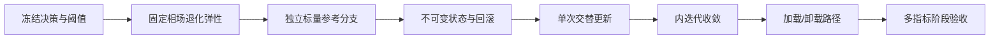

# 004：Griffith 2D 交替耦合与准静态载荷步基准

| 属性 | 内容 |
| --- | --- |
| 项目 | `griffith2d` |
| 状态 | 已完成 |
| 阶段 | 阶段 4：退化弹性、历史场交替耦合与准静态路径 |
| 理论规范 | [`../../tutorials/pinn-dem-phase-field-derivation.md`](../../tutorials/pinn-dem-phase-field-derivation.md) 第 7–9 节 |
| 模块规范 | [`../../griffith2d/README.md`](../../griffith2d/README.md) |
| 前置计划 | [`001`](001-griffith2d-physics-core.md)、[`002`](002-griffith2d-quadrature-elastic-dem.md)、[`003`](003-griffith2d-at2-phase-field.md)，均已完成 |
| 后续计划 | Griffith 二维预裂纹与裂纹扩展基准（待编号） |

## 1. 阶段目标

在不引入二维裂纹尖端、几何不连续或新不可逆算法的条件下，建立第一条可独立验证的耦合演化链：

1. 给定冻结相场，求解退化弹性位移子问题；
2. 从位移场计算 Amor 活性能 $\psi^+$；
3. 用逐点最大值更新历史场；
4. 给定冻结历史场，求解 AT2 相场子问题；
5. 在每个载荷步内交替迭代，直到位移、相场、历史场和能量指标同时收敛；
6. 在加载、卸载和再加载路径上验证反力、历史保持、相场响应和可复现性。

阶段 4 只建立分块历史场基线。它验证数值闭环是否忠实实现选定代理模型，不声称求得原始严格
不可逆联合泛函的全局极小值。

## 2. 为什么不能直接进入二维 Griffith 裂纹

阶段 2 已分别验证纯弹性 DEM，阶段 3 已分别验证冻结历史场相场 DEM，但尚未验证以下接口：

- 相场如何进入退化弹性能和退化应力；
- 位移解产生的 $\psi^+$ 如何映射到相场积分点；
- 历史更新发生在载荷步与内迭代的哪个位置；
- 两个神经子问题如何热启动和判断收敛；
- 卸载时历史与相场保持、位移和反力回退的关系；
- 子问题优化误差是否会被误判为耦合不收敛。

若这些问题与裂纹尖端、二维相场带和 Griffith 临界载荷同时出现，失败将无法归因。因此本阶段使用
空间均匀且具有解析或高精度标量参考解的基准隔离耦合算法。

## 3. 模型与参考关系

### 3.1 冻结相场的退化位移子问题

给定 $\phi$，位移子问题最小化

$$
\Pi_u[\boldsymbol u;\phi]
=\int_\Omega
\left[g(\phi)\psi^+(\boldsymbol\varepsilon(\boldsymbol u))
+\psi^-(\boldsymbol\varepsilon(\boldsymbol u))\right]d\Omega
-W_{\rm ext}[\boldsymbol u],
$$

其中

$$
g(\phi)=(1-\phi)^2+k.
$$

相场在该子问题内必须冻结并与位移求积点对齐。训练目标不加入平衡残差；平衡、牵引、反力和边界
误差仍作为后验诊断。

### 3.2 位移到历史场

位移子问题收敛后，在固定的耦合积分点计算

$$
\psi^+=\psi^+(\boldsymbol\varepsilon(\boldsymbol u)),
\qquad
\mathcal H^{(j+1)}=
\max\left(\mathcal H_n,\mathcal H^{(j)},\psi^+(\boldsymbol u^{(j+1)})\right),
$$

其中 $n$ 表示上一收敛载荷步，$j$ 表示当前步内迭代。历史状态必须显式传入和返回，禁止被子问题
求解器隐藏或原位修改。

### 3.3 冻结历史场的相场子问题

相场子问题沿用计划 003：

$$
\mathcal E_\phi[\phi;\mathcal H]
=\int_\Omega\left[
(1-\phi)^2\mathcal H
+G_c\left(\frac{\phi^2}{2l_0}
+\frac{l_0}{2}|\nabla\phi|^2\right)
\right]d\Omega.
$$

当前阶段继续使用历史场代理，不额外叠加 $\phi_n\ge\phi_{n-1}$ 的罚项、投影或主动集。

## 4. 两级验证基准

### 4.1 基准 A：固定均匀相场下的退化弹性

沿用阶段 2 的矩形平面应变均匀拉伸，在整个区域给定常量 $\phi_0$。对正体积均匀拉伸，Amor
非活性能为零，故退化因子是空间常量。给定边界牵引 $T$ 时，解析应变和位移为无损解除以
$g(\phi_0)$：

$$
\boldsymbol\varepsilon(\phi_0,T)
=\frac{\boldsymbol\varepsilon_0(T)}{g(\phi_0)},
\qquad
\boldsymbol u(\phi_0,T)
=\frac{\boldsymbol u_0(T)}{g(\phi_0)}.
$$

退化应力仍满足边界牵引，柔度增加为原来的 $1/g(\phi_0)$。至少测试 $\phi_0=0$、一个中间值和
接近 1 的值，但避免 $g$ 太小导致基准被条件数主导。

该基准验证：

- 退化弹性能组装，而不是无损能量复用；
- 相场张量与位移求积点的形状、dtype 和 device 契约；
- 退化应力、边界牵引、反力与解析柔度；
- $k$ 的约定，包括 $g(0)=1+k$；
- 固定相场时训练结果的确定性。

### 4.2 基准 B：均匀牵引下的双向耦合标量分支

仍使用均匀拉伸矩形。定义该平面应变边值问题的有效模量

$$
E_{\rm eff}=\frac{T}{\varepsilon_{xx,0}(T)}
=\frac{4\mu(\lambda+\mu)}{\lambda+2\mu},
$$

以及无量纲牵引

$$
\tau=T\sqrt{\frac{l_0}{E_{\rm eff}G_c}}.
$$

在单调加载、均匀拉伸且 $\psi^-=0$ 的稳定分支上，

$$
\varepsilon_{xx}=\frac{T}{E_{\rm eff}g(\phi)},
\qquad
\overline H=\frac{\mathcal H l_0}{G_c}
=\frac{\tau^2}{2g(\phi)^2},
$$

而均匀 AT2 相场满足

$$
\phi=\frac{2\overline H}{1+2\overline H}
=\frac{\tau^2}{g(\phi)^2+\tau^2}.
$$

由此得到独立标量残差

$$
F(\phi;\tau,k)
=\phi\left[g(\phi)^2+\tau^2\right]-\tau^2=0.
$$

对应的交替固定点映射为

$$
Q(\phi;\tau,k)=\frac{\tau^2}{g(\phi)^2+\tau^2},
\qquad
Q'(\phi)=\frac{4\tau^2g(\phi)(1-\phi)}{
\left[g(\phi)^2+\tau^2\right]^2}.
$$

本阶段将 $|Q'(\phi)|<1$ 作为未松弛 Gauss–Seidel 固定点的局部稳定检查，并同时要求
$\partial F/\partial\phi\ne0$。两者用途不同：前者判断所选交替迭代是否局部收敛，后者排除标量根的
切线退化。

正式参考解应由确定性高精度标量算法在指定延续分支上求得，而不是调用神经求解器或复用其损失。
低载荷区间、载荷步和根分支必须在训练前冻结。独立扫描表明 $k>0$ 时低载荷也可能同时存在低损伤
稳定根、中间不稳定根和近完全损伤稳定根；本阶段必须从 $(\tau,\phi)=(0,0)$ 连续延拓选择低损伤
分支，并报告全部候选根。若所选分支切线退化或失去固定点稳定性，则停止本阶段基准，不得通过神经
训练结果反向挑选参考根。

### 4.3 加载、卸载与再加载路径

基准 B 至少包含以下路径：

1. 从零逐步加载到冻结的低载荷上限；
2. 卸载到较低牵引；
3. 再加载但不超过历史峰值；
4. 再加载并超过历史峰值。

历史场和相场在步骤 2–3 应保持峰值状态，位移则随当前牵引回退或恢复；超过旧峰值后历史和相场
继续增长。该结论只适用于本基准的均匀稳定分支，不推广为历史场方法对任意非均匀问题的严格
不可逆证明。

卸载时必须区分当前牵引 $\tau_n$ 与历史峰值牵引 $\tau_{\max}$：$\phi_n$ 由已提交历史峰值决定，
而当前位移满足

$$
\varepsilon_{xx,n}
=\frac{T_n}{E_{\rm eff}g(\phi_n)}.
$$

因此冻结相场不等于冻结力学响应。

## 5. 交替算法契约

每个载荷步 $n$ 的建议顺序为：

1. 从上一收敛状态热启动 $\boldsymbol u_n^{(0)}$、$\phi_n^{(0)}$ 和 $\mathcal H_n^{(0)}$；
2. 固定 $\phi_n^{(j)}$，求位移子问题；
3. 在统一耦合积分点计算 $\psi^+$；
4. 以逐点最大值更新候选历史场；
5. 固定候选历史场，求相场子问题；
6. 计算场增量、历史增量、子问题梯度/停止原因、能量分项和物理残差；
7. 全部达到冻结阈值后提交不可变的新载荷步状态，否则继续迭代；
8. 达到内迭代上限时整步失败，不提交部分状态。

载荷步状态至少包含载荷参数、位移模型状态、相场模型状态、历史张量、反力、能量分项、内迭代记录
和停止原因。失败步不得污染最后一个已收敛状态。

## 6. 范围

### 6.1 范围内

- 固定相场下的退化弹性势能与训练器；
- 均匀退化弹性解析参考；
- 位移求积点上的 Amor $\psi^+$ 提取；
- 显式历史状态更新和提交；
- 既有位移模型与均匀标量相场状态的热启动接口；
- 历史场分块交替迭代；
- 确定性载荷调度和加载/卸载/再加载；
- 均匀耦合标量参考方程及分支检查；
- 位移、相场、历史和能量的多指标内迭代收敛；
- 反力—载荷、柔度、能量、平衡、边界和单调性诊断；
- 失败载荷步的事务式状态回滚；
- 两份稳定配置和具名 JSON 结果；
- CPU 基线及关键张量路径 CUDA 测试。

### 6.2 范围外

- 二维预裂纹、裂纹尖端场和裂纹扩展；
- 非均匀相场到位移积分点的插值或投影；
- 自适应载荷步和弧长法；
- 失稳后分支、snap-back 和多根选择算法；
- 严格约束 $\phi_n\ge\phi_{n-1}$ 的主动集、罚函数或增广拉格朗日；
- 联合 DRM、强形式耦合 PINN 和算法对比；
- 网络架构、优化器、动态权重和随机积分实验；
- Griffith 临界载荷、应力强度因子和 $J$ 积分；
- 检查点文件格式和长时任务恢复。

## 7. 理论到实现的追踪

| 理论对象 | 目标模块 | 首要验证 |
| --- | --- | --- |
| $g(\phi)\psi^++\psi^-$ | `solvers/degraded_elastic_dem` | 固定均匀相场解析柔度 |
| $\psi^+(\boldsymbol u)$ | `diagnostics/coupling` | 解析均匀应变与自动微分 |
| $\mathcal H=\max\psi^+$ | `physics/history` 与 `solvers/staggered` | 加载/卸载序列 |
| 冻结历史场相场子问题 | `solvers/staggered` | 标量相场能量与阶段 3 均匀解析解等价性 |
| 内迭代固定点 | `solvers/staggered` | 标量方程 $F(\phi;\tau,k)=0$ |
| 准静态载荷状态 | `solvers/load_path` | 提交、失败回滚与可复现性 |
| 反力和多能量分项 | `diagnostics/coupling` | 解析载荷路径与能量平衡 |

## 8. 前置设计决策

### 004-D01：耦合算法

- **状态：** 已决定
- **建议：** 采用位移 → 历史更新 → 相场的 Gauss–Seidel 分块顺序；本阶段不实现联合训练。
- **验收依据：** 单场求解器可单独复验，每次内迭代记录输入和输出状态。

### 004-D02：历史更新时间

- **状态：** 已决定
- **建议：** 当前步每次位移子问题后更新候选历史场，但只在整步收敛后提交；更新同时包含上一载荷步和当前内迭代最大值。
- **验收依据：** 卸载不下降，失败步不污染已提交历史。

### 004-D03：热启动所有权

- **状态：** 已决定
- **建议：** 位移训练器支持显式传入现有模型或参数状态；均匀相场使用独立标量参数并显式热启动。调用者拥有快照和回滚。
- **验收依据：** 冷启动与热启动得到同一解析解，热启动减少或不增加稳定路径上的工作量。

### 004-D04：耦合积分点

- **状态：** 已决定
- **建议：** 本阶段位移和历史使用同一确定性矩形求积规则；相场是单个可训练标量自由度，并通过具名函数显式扩展到该规则，禁止依靠隐式广播。一维相场网络继续作为阶段 3 回归，二维非均匀相场表示和跨网格传递延后。
- **验收依据：** 点序、形状、dtype 和 device 均有显式契约测试。

### 004-D05：收敛判据

- **状态：** 已决定
- **建议：** 同时冻结位移相对增量、相场最大增量、历史最大增量、能量相对变化和两个子问题停止状态；禁止只用总 loss 或单一场增量。
- **验收依据：** 人工未收敛序列不能被误判为收敛。

### 004-D06：标量参考分支

- **状态：** 已决定
- **建议：** 先扫描并括区间求出 $[0,1]$ 内全部根，再从上一状态连续延拓选择低损伤稳定分支；在每一步报告根数，并检查 $|Q'|$、$\partial F/\partial\phi$ 和分支连续性。
- **验收依据：** 参考算法独立于 PyTorch 优化器，能复现多根事实，并有代回残差与高精度交叉检查。

### 004-D07：载荷调度

- **状态：** 已决定
- **建议：** 使用配置中显式列出的固定载荷序列，覆盖加载、卸载、峰值内再加载和超峰值再加载；本阶段不自适应修改步长。
- **验收依据：** 每一步预期历史峰值可由解析序列计算。

### 004-D08：残余刚度约定

- **状态：** 已决定
- **建议：** 保持现有 $g=(1-\phi)^2+k$，明确 $g(0)=1+k$；参考解和数值解不得偷偷归一化为 $g(0)=1$。
- **验收依据：** $\phi=0$ 固定相场基准能区分两种约定。

### 004-D09：失败语义

- **状态：** 已决定
- **建议：** 超过内迭代或子问题预算时返回具名失败结果并保留最后已提交状态；禁止提交半收敛状态。
- **验收依据：** 强制失败测试后，模型参数、历史和载荷索引与步前快照一致。

## 9. 开发任务

### 9.1 退化位移子问题

- [x] **004-T01（已完成）** 固化 004-D01 至 004-D09。
- [x] **004-T02（已完成）** 定义冻结相场、耦合点和载荷步状态契约。
- [x] **004-T03（已完成）** 实现退化弹性势能组装及能量分项。
- [x] **004-T04（已完成）** 实现固定相场位移训练器和热启动接口。
- [x] **004-T05（已完成）** 实现均匀退化弹性解析参考。
- [x] **004-T06（已完成）** 验证多个常量相场下的位移、应变、应力、反力和柔度。
- [x] **004-T07（已完成）** 验证 $g(0)=1+k$、无静默归一化和 CPU/CUDA 张量契约。

### 9.2 耦合参考与状态

- [x] **004-T08（已完成）** 实现均匀标量相场表示、矩形相场能量及位移场到积分点 $\psi^+$ 的纯函数。
- [x] **004-T09（已完成）** 实现无量纲牵引、有效模量和标量残差 $F$。
- [x] **004-T10（已完成）** 实现独立括区间根求解与稳定分支检查。
- [x] **004-T11（已完成）** 定义不可变载荷步状态、内迭代记录和失败结果。
- [x] **004-T12（已完成）** 实现模型、历史和指标的快照/提交/回滚语义。
- [x] **004-T13（已完成）** 建立解析加载、卸载、再加载历史序列。

### 9.3 交替求解与载荷路径

- [x] **004-T14（已完成）** 实现单次位移 → 历史 → 相场交替更新。
- [x] **004-T15（已完成）** 实现多指标内迭代收敛判据。
- [x] **004-T16（已完成）** 实现单载荷步求解和失败回滚。
- [x] **004-T17（已完成）** 实现固定载荷路径驱动器。
- [x] **004-T18（已完成）** 实现位移、相场、历史、反力和能量路径诊断。
- [x] **004-T19（已完成）** 验证单调加载的神经解与标量稳定分支。
- [x] **004-T20（已完成）** 验证卸载和峰值内再加载时历史/相场保持。
- [x] **004-T21（已完成）** 验证超峰值再加载时历史/相场继续增长。
- [x] **004-T22（已完成）** 验证相同配置的完整路径逐步确定性。

### 9.4 稳定入口与验收

- [x] **004-T23（已完成）** 冻结固定相场和耦合载荷路径两份完整配置。
- [x] **004-T24（已完成）** 增加具名 JSON 稳定入口，输出每步与每次内迭代记录。
- [x] **004-T25（已完成）** 增加公式级、基准和集成测试。
- [x] **004-T26（已完成）** 更新 README、API 文档与理论追踪。
- [x] **004-T27（已完成）** 运行完整阶段验收并记录证据。

## 10. 阶段验收

- [x] **004-A01** 退化弹性势能与 `degraded_elastic_energy` 在手算状态下一致。
- [x] **004-A02** 固定均匀相场基准在冻结的位移、应变、应力、反力、平衡和牵引阈值内通过。
- [x] **004-A03** 至少三个常量相场值恢复 $1/g(\phi)$ 柔度比例，包括可区分 $g(0)=1+k$ 的状态。
- [x] **004-A04** $\psi^+$ 提取与解析均匀应变一致，且不修改位移模型或历史状态。
- [x] **004-A05** 标量参考枚举全部候选根；所选低损伤根代回 $F$ 达到冻结容差，并通过分支连续性与稳定性检查。
- [x] **004-A06** 单调加载各步的位移、相场、历史和反力与独立标量参考解一致。
- [x] **004-A07** 卸载和未超峰值再加载时历史与相场不下降且不增加，位移随当前牵引响应。
- [x] **004-A08** 超过旧峰值后历史和相场继续增长，且逐点历史保持最大值语义。
- [x] **004-A09** 每个成功载荷步同时满足全部冻结内迭代判据，不以单一 loss 宣告收敛。
- [x] **004-A10** 强制失败的载荷步不改变最后已提交的模型、历史、指标和载荷索引。
- [x] **004-A11** 热启动与冷启动收敛到同一参考分支，且稳定路径上热启动工作量不增加。
- [x] **004-A12** 所有输出显式报告当前载荷、反力、$\min/\max\phi$、历史峰值、能量分项、场增量、残差和停止原因。
- [x] **004-A13** 相同配置重复完整路径的参数、状态、指标和停止原因在冻结容差内一致。
- [x] **004-A14** 核心不依赖旧 `griffith`、实验目录、网络连接或人工挑选检查点。
- [x] **004-A15** CPU 完整基线与关键 CUDA 张量路径通过，计划 001–003 回归测试继续通过。
- [x] **004-A16** 文档明确历史场代理、低载荷稳定分支和空间均匀基准的结论边界。

## 11. 风险与控制

### 004-R01：均匀基准被误认为二维裂纹证据

- **风险：** 均匀闭环不能验证裂纹尖端、非均匀场传递或裂纹扩展。
- **控制：** 验收结论限定为耦合接口和载荷路径；二维 Griffith 保留为下一阶段。

### 004-R02：标量方程存在多根或失稳

- **风险：** 牵引控制下退化反馈可能产生多根、极限点或 snap-back。
- **控制：** 枚举全部候选根，从零状态连续选择低损伤稳定分支；检查 $|Q'|$ 与 $\partial F/\partial\phi$，发现所选分支失稳即停止而非按训练结果挑根。

### 004-R03：残余刚度约定不一致

- **风险：** 数值代码使用 $g=(1-\phi)^2+k$，参考推导却默认 $g(0)=1$。
- **控制：** 所有参考公式显式包含 $k$，并用 $\phi=0$ 基准锁住 $1+k$。

### 004-R04：冷启动噪声伪装成路径依赖

- **风险：** 每次子问题重建网络会使优化差异被误读为材料历史效应。
- **控制：** 显式热启动、固定种子，并分别记录子问题优化工作量和物理状态变化。

### 004-R05：历史场更新时机错误

- **风险：** 只在载荷步末更新可能漏掉内迭代峰值；过早提交则让失败步污染历史。
- **控制：** 区分候选历史与已提交历史，步内取最大、收敛后一次提交。

### 004-R06：不同积分点之间隐式广播

- **风险：** 相场、历史和位移能量因 shape 可广播而在错误点序上悄然组合。
- **控制：** 历史与位移共享同一 `QuadratureRule` 身份和点序；标量相场必须由具名扩展函数生成完整点值张量，禁止仅凭可广播形状接受输入。

### 004-R07：子问题收敛不等于耦合收敛

- **风险：** 两个优化器各自停止，但场固定点仍在变化。
- **控制：** 独立检查子问题停止状态、场增量、历史增量、能量变化和标量参考误差。

### 004-R08：卸载响应被错误冻结

- **风险：** 为保持历史和相场而连位移模型也不更新，导致卸载反力/位移错误。
- **控制：** 每个载荷步均重解或热启动位移子问题；只冻结不可逆历史，不冻结当前力学平衡。

### 004-R09：历史场被误称为严格变分不可逆

- **风险：** 均匀序列通过后错误推广到任意非均匀裂纹问题。
- **控制：** API 和文档继续使用 `history`/`candidate_history` 命名，并保留相场下降诊断。

### 004-R10：失败步留下半更新模型

- **风险：** 神经网络参数已原位优化，简单丢弃历史张量不足以回滚。
- **控制：** 步前保存模型状态与优化状态的独立快照，失败测试逐项比较。

## 12. 执行顺序

执行顺序为 `T01–T07 → T08–T13 → T14–T18 → T19–T22 → T23–T27`。固定相场位移基准未通过前
不得实现交替循环；标量参考分支未冻结前不得训练耦合路径；单载荷步和回滚未通过前不得运行完整
路径；本阶段通过前不得进入二维 Griffith 裂纹。

## 13. 验收记录

阶段 4 已按“固定相场退化弹性 → 独立标量分支 → 事务状态 → 交替路径”的顺序完成。

| 项目 | 记录 |
| --- | --- |
| 测试命令 | `C:\Users\seanwang\miniforge3\envs\general\python.exe -m pytest -q` |
| Python/PyTorch 环境 | Python `general` 环境；PyTorch `2.12.0+cu132`；pytest `9.0.3` |
| 固定相场退化弹性指标 | $\phi=0,0.4,0.8$ 的柔度、应力与能量公式测试通过；稳定配置冻结完整后验阈值 |
| 标量参考分支与载荷范围 | $T=[0,0.02,0.04,0.02,0.03,0.05]$；最大相场参考误差约 $8.0\times10^{-8}$；部分载荷枚举 3 个根 |
| 单调加载耦合指标 | 所有正载荷步 2 次内迭代提交；最大位移与反力相对误差均低于 $2\%$ |
| 卸载/再加载指标 | $0.04\to0.02\to0.03$ 时历史与相场逐位保持；$0.05$ 时二者继续增长 |
| 内迭代与热启动工作量 | 同一固定相场冷/热启动最终势能逐位相同；L-BFGS 闭包次数由 213 降至 1 |
| 失败回滚证据 | 产生候选位移、历史和相场后强制耗尽内迭代，返回原已提交状态对象 |
| 重复路径一致性 | 两次完整路径的 JSON 字段逐项相等，网络状态 SHA-256 逐步相等 |
| CPU/CUDA 覆盖 | CPU 完整路径通过；相场扩展、标量更新及既有关键物理张量 CUDA 测试通过 |
| 已知限制 | 仅为空间均匀、低损伤稳定分支的历史场代理；不覆盖二维裂纹、失稳后分支或严格变分不可逆性 |
| 验收人及日期 | GitHub Copilot，2026-08-31 |

## 14. 变更记录

| 日期 | 变更 | 原因 |
| --- | --- | --- |
| 2026-08-31 | 创建计划 004 | 计划 003 验收后，进入可解析的历史场分块耦合与准静态载荷路径阶段 |
| 2026-08-31 | 完成计划 004 | 退化弹性、独立标量参考、事务交替路径、稳定入口及 CPU/CUDA 验收通过 |
