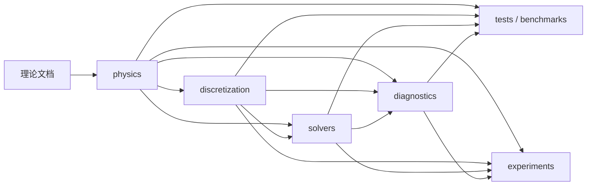

# Griffith 2D：理论驱动的 PINN/DEM 相场断裂实现

`griffith2d` 是二维 Griffith 相场断裂的新实现。项目以
[理论推导](../tutorials/pinn-dem-phase-field-derivation.md)为规范来源，先建立可验证的基础计算核心，
再通过外围实验探索网络架构、离散方式和求解策略。

旧目录 [`../griffith`](../griffith) 仅作为历史基线和经验记录；新实现不直接复制其中的训练流程或
实验代码。旧实现中的方案只有在理论依据明确、接口职责清楚且通过独立验证后，才进入本项目。

## 设计目标

1. **理论决定核心。** 物理公式必须能够追溯到理论文档，不由某次训练现象反向定义。
2. **物理与数值分离。** 本构、能量和不可逆性不依赖网络宽度、优化器或采样方案。
3. **验证先于耦合。** 先验证张量、能量和单场问题，再训练完整 Griffith 算例。
4. **实验位于外围。** 临时方案可以依赖核心，核心不能依赖任何实验。
5. **失败必须可定位。** 分别观察模型误差、离散误差和优化误差，不用单一总 loss 代替诊断。
6. **配置不是物理实现。** 配置只选择已有模型和算法，不复制公式或隐藏新的物理假设。

## 目录结构

```text
griffith2d/
├── README.md
├── configs/
│   └── baselines/            # 通过验证的基线配置
├── src/
│   └── griffith2d/
│       ├── physics/          # 连续模型和能量定义
│       ├── discretization/   # 网络试探空间、自动微分、积分与采样
│       ├── solvers/          # 单场及耦合求解流程
│       └── diagnostics/      # 物理量、误差和收敛指标
├── tests/
│   ├── unit/                 # 公式级与局部数值测试
│   ├── benchmarks/           # 有解析解或可信参考解的算例
│   └── integration/          # 跨模块和完整求解流程测试
├── experiments/
│   ├── configs/              # 尚在评估的实验配置
│   ├── runners/              # 临时实验入口
│   └── analysis/             # 实验比较与结果分析
├── scripts/                  # 稳定、可复用的训练与评估入口
└── artifacts/
    ├── runs/                 # 日志、指标和配置快照
    ├── figures/              # 生成的图像
    └── checkpoints/          # 模型权重与求解状态
```

当前已完成阶段 1 的物理核心，包括材料参数、小应变、平面应变三维体积—偏应变分解、
Amor 能量分解、二次退化函数、退化弹性能和解析应力。实现状态与验收证据见
[`../docs/plans/001-griffith2d-physics-core.md`](../docs/plans/001-griffith2d-physics-core.md)。

阶段 2 也已完成：当前具有确定性 Gauss–Legendre 区间、线段和矩形求积，固定 `tanh`
位移网络，精确对称边界试探解，逐点空间 Jacobian，纯弹性总势能组装，以及带解析场、
反力、牵引和平衡残差诊断的二维 DEM 基准。验收记录见
[`../docs/plans/002-griffith2d-quadrature-elastic-dem.md`](../docs/plans/002-griffith2d-quadrature-elastic-dem.md)。

阶段 3 已完成：当前具有 AT2 裂纹能、显式历史场尺度与纯更新函数、相场一阶/二阶自动微分、
预裂纹硬试探解、独立相场 DEM，以及有限区间预裂纹和均匀历史场两个解析基准。历史场方法在
本项目中明确作为冻结驱动力代理，不声称等价于严格相场不可逆约束。验收记录见
[`../docs/plans/003-griffith2d-at2-phase-field.md`](../docs/plans/003-griffith2d-at2-phase-field.md)。

阶段 4 已完成：当前具有冻结均匀相场退化弹性 DEM、独立多根标量参考与低损伤分支延拓、
候选/已提交历史状态、事务式载荷步回滚，以及覆盖单调加载、卸载、峰值内重载和超峰值重载的
固定准静态路径。该阶段只验证空间均匀历史场代理的耦合接口，不构成二维裂纹扩展证据。验收记录见
[`../docs/plans/004-griffith2d-staggered-coupling.md`](../docs/plans/004-griffith2d-staggered-coupling.md)。

阶段 5 的 T05 位移试探场组件已完成：`PlateDisplacementTrialSolution` 使用全域归一化坐标，
严格施加上下边竖向位移，仅在原点消去水平刚体平移，不锁定整条中心线或侧边。
独立位移尺度保留零载荷时的内部可学习变化；无损仿射泊松收缩、手算/参数梯度及
CPU/CUDA 接口测试通过。自然牵引需由后续能量求解验证，不由试探场自动保证。
这不代表冻结预裂纹训练或扩展基线通过；公式、测试和门禁见
[`../docs/plans/005-griffith2d-precrack-propagation.md`](../docs/plans/005-griffith2d-precrack-propagation.md)。

## 核心模块

T06 已启动：`frozen_plate_elastic_energy` 和 `train_frozen_plate_elastic_dem` 支持显式积分规则及
逐积分点冻结非均匀相场，只优化位移控制的弹性储能，不沿用牵引外功、不修改相场或初始网络。
返回最终参数梯度和具名停止标记；未达驻点的是候选，不可当作已验收解或已提交耦合状态。
CPU/CUDA 组件测试和全项目 247 项回归通过。预裂纹积分加密、独立 FEM 场量/反力/能量及
自由边牵引对照尚未开展；参数驻点不等于这些验收已通过，T06 仍进行中。

### `src/griffith2d/physics`

连续物理模型的唯一实现位置，预计包括：

- 小变形运动学与应变计算；
- 各向同性线弹性参数；
- Amor 拉压能量分解；
- 相场退化函数；
- AT2 裂纹表面能；
- 内部能、外力势与总势能；
- 历史场或其他不可逆性约束；
- 一致的无量纲化；
- 边界和初始裂纹的物理定义。

该模块只表达“求解什么”，不得导入网络、优化器、训练循环或实验配置。

### `src/griffith2d/discretization`

负责把连续场和积分离散为可计算对象，预计包括：

- 位移场与相场的神经网络表示；
- 本质边界条件的试探解构造；
- 自动微分算子；
- 确定性求积与随机采样；
- 积分点、权重和区域划分；
- 网络输出到物理场的映射。

该模块可以依赖 `physics`，但不能修改物理公式来适配某个网络或采样器。

### `src/griffith2d/solvers`

组织求解算法，预计包括：

- 固定相场下的位移求解；
- 给定驱动力下的相场求解；
- 交替最小化；
- 联合优化的对照实现；
- 载荷步推进、收敛判据和状态恢复；
- 优化器调度与检查点管理。

求解器组合 `physics` 与 `discretization`，但不重复本构、能量或积分公式。

### `src/griffith2d/diagnostics`

集中定义训练和验证所需的可观测量，预计包括：

- 弹性能、断裂能、外力势和总势能；
- 平衡残差和边界误差；
- 不可逆性违反量；
- 位移、应力和相场剖面误差；
- 梯度范数、积分收敛和载荷步收敛指标；
- Griffith 解析基准比较所需的数据。

诊断代码只读取状态，不应改变训练过程或模型参数。

## 依赖方向

核心依赖必须保持单向：



禁止以下反向依赖：

- `physics` 依赖 `discretization`、`solvers` 或 `experiments`；
- 核心模块读取某个实验目录的配置；
- `scripts` 或 `experiments` 内重新实现能量、本构和边界公式；
- 为了降低训练 loss 而在实验中静默改变物理模型。

独立交叉核验参考是公式集中实现的明确例外：现有 `src/griffith2d/benchmarks` 下的
参考实现可独立表达被检验的公式和离散方法，但须标明理论来源、参考角色及验证范围，
保留解析测试、收敛证据和重建入口。该例外不允许普通实验或入口复制物理公式；
生产核心不得反向依赖参考求解器或参考配置。共享被检验的关键公式函数时，结果一致
不构成该公式实现正确的独立证据；使用不同求解库也不自动保证正确。

## 验证顺序

完整耦合训练不是第一个里程碑。实现应按以下顺序逐级通过验证：

1. **张量与能量单元测试**
   - 刚体平移和小刚体转动不产生小应变；
   - 应力等于能量对应变的导数；
   - 均匀应变状态与解析能量一致；
   - 拉压分解和退化函数满足极限情况。
2. **数值积分测试**
   - 常数和低阶多项式积分达到预期精度；
   - 分区积分权重、面积和量纲一致；
   - 随积分辨率增加，能量稳定收敛。
3. **纯弹性基准**
   - 无裂纹问题恢复解析位移和应力；
   - 平衡残差、边界误差与能量误差同时报告。
4. **固定相场的位移问题**
   - 在已知退化场下验证位移平衡和应力响应。
5. **给定驱动力的相场问题**
   - 验证一维 AT2 裂纹剖面、长度尺度和不可逆性。
6. **位移—相场耦合问题**
   - 验证交替迭代、载荷步和能量演化。
7. **二维 Griffith 基准**
   - 最后比较解析基准、有限域修正及收敛行为。

按实际依赖逐级验证：组件开发和局部测试不必等待完整扩展基线通过，但完整耦合训练
必须先通过相关单场与参考门禁。组件正确、开放实验执行完毕和完整基线通过是不同结论，
分别记录证据；如实报告未收敛并拒绝提交不合格状态，也可以证明失败语义实现正确。
各计划原定的完整验收要求不因组件通过或失败实验已记录而降低。

## 实验约定

每个实验在运行前必须写明：

- **问题**：当前需检验的行为、未知量或未达到基线的可观测现象；
- **假设**：预期关系、适用范围及所提修改的依据；
- **自变量**：主动改变的因素；多因素比较须预先声明对照设计和交互作用，不能混改后归因于单一因素；
- **控制量**：必须保持不变的物理、离散和训练设置；
- **否证判据**：什么结果意味着假设不成立；
- **比较指标**：不能只报告总 loss；
- **随机性**：种子数量及汇总方式；
- **预算**：最大运行规模、迭代或资源上限；
- **退出条件**：实验何时停止，以及代码何时删除或晋升。

保持目标模型与演化问题不变的求解方法实验，须与改变能量分解、退化函数或不可逆处理的
模型对照分开。历史更新、相场下界与提交时机的差异应具名记录并随结果保存，
比较前明确差异，统一前通过设计决策，不静默替换旧行为。

建议每个实验使用独立、带日期或主题名称的配置。运行结果写入 `artifacts/runs`，图像写入
`artifacts/figures`，权重写入 `artifacts/checkpoints`。任何生成文件都不能成为核心模块的隐式输入。

每次运行还须保存完整配置、代码版本或可恢复的工作区差异与相关未跟踪源码、解释器/依赖
及必要运行设置、随机性、指标、停止原因和结论边界。确定性求解注明不使用随机初始化。
失败单独归档错误、失败步、已提交前缀及重建方式，不输出假成功；预算不足或实现错误
不能当作假设被否证。参考生成器已提供 schema v2 的源码/配置快照、运行环境与可捕获失败归档；
旧 schema v1 结果仍保留原证据边界，不追溯补写版本信息。原生进程退出或归档介质失效不保证有完整档案。

实验结论与执行状态分别记录，候选实现有三种去向：

1. 被否证或没有复用价值：保留可重建证据后可退出主代码，不要求立即删除所有临时实现；
2. 证据不足：保留在 `experiments`，不得进入基线；
3. 适用范围内独立验证通过且有实际复用需求：提炼接口、补齐测试与文档后晋升核心可选组件。

晋升核心可选组件不等于成为默认方案；默认值仍需对应基线的比较、回归和复现证据，
并记录代价与适用范围。一次参数扫描的设置通常留在配置，不必新增核心抽象。

## 基线配置与脚本

`configs/baselines` 只保存通过对应验证层级的稳定配置。配置应包含完整参数并可独立复现，
不得依赖代码中的隐式默认值。

`scripts` 只放稳定入口，例如基准测试、正式训练、评估和绘图。一次性的参数扫描、诊断探针和
消融入口应留在 `experiments/runners`，避免稳定入口随实验数量膨胀。

## 实施阶段

**阶段 1 至阶段 3**已完成。完整测试命令为：

```powershell
Set-Location griffith2d
conda activate general
$env:MKL_THREADING_LAYER = 'SEQUENTIAL'
python -m pytest -q
```

独立有限域预裂纹参考另需可选的 `scikit-fem` 依赖；在上述环境中执行：

```powershell
python -m pip install -e '.[reference,test]'
python -m pytest tests/integration/test_center_crack_fem.py -q
```

阶段 5 的低载荷 FEM 参考路径可由完整 TOML 配置重建：

```powershell
python -m griffith2d.benchmarks.center_crack_fem --config configs/references/center_crack_path.toml --output results/references/center_crack_path_12_evidence_v2.json
```

此配置是参考生成样例，不是已验收的裂纹扩展训练基线。路径为顶边位移
`0/0.01/0.02/0.01/0`，底边位移相反，单位厚度、平面应变。JSON 保存配置、库版本、
节点/三角形拓扑、逐步位移/相场/历史、反力、弹性及裂纹能、带符号双边梯形外功、
不可逆违反量和内迭代诊断。外功与总能量增量之差仅作诊断；节点历史代理不保证严格能量平衡。
生成器只有整条路径成功后才写结果，失败抛错并停止，不跳过失败载荷点。
当前 JSON 的 `schema_version=2`，`provenance` 在求解前保存相关 Git 提交/工作区状态、
完整 `src/griffith2d` Python 源码及可用的 `pyproject.toml` 逐字节快照、实际使用的配置快照，
并附 SHA-256。即使源码未跟踪、Git 不可用或文件非 UTF-8，base64 快照仍可恢复。
运行环境包括 Python/平台、解释器、依赖版本及 conda/MKL/线程设置，明确不使用随机初始化。
新记录 [results/references/center_crack_path_12_evidence_v2.json](results/references/center_crack_path_12_evidence_v2.json)
不覆盖既有 schema v1 的低载荷记录。

求解或配置解析失败时默认在输出目录写 `<输出名>.<run_id>.failure.json`；无 `--output` 时写入
`results/references/<run_id>.failure.json`。可用 `--failure-output` 指定新档案路径；
失败路径不得与成功路径相同，也不得已存在。档案包含源码/配置/环境、错误及 traceback、
失败载荷步、完整已提交前缀和原运行命令。随后重新抛出原始异常；旧成功结果不被覆盖。
配置不存在、证据采集自身失败、原生退出或进程被杀不属于当前 Python 归档保证范围；
档案写入失败会报告并附注于原始求解异常，不伪装为成功。

恢复时先校验 SHA-256，在新的目录中按快照相对路径恢复完整源码和构建配置，再恢复
配置快照并按记录安装依赖/设置环境，运行同一模块入口。不要只在旧源码树上覆盖部分文件，
否则已删除的模块可能残留；路径故障从完整载荷序列重跑，不把失败前缀当作成功结果或检查点。
参考实现依赖 `scikit-fem`（BSD-3-Clause，https://github.com/kinnala/scikit-fem），
输出数据由本项目自行计算，不是外部文献数据；尚未宣称整体网格无关或临界载荷准确性。

Windows 下不要直接调用未激活环境的 `python.exe` 跑较大网格：缺少环境的
`Library\bin` DLL 路径会导致数值库原生退出；同时加载 PyTorch 和 MKL 时，
上述顺序 MKL 设置避免两个 OpenMP 运行时冲突。

安装本地包后，可运行稳定的纯弹性 DEM 基准：

```powershell
python -m pip install -e .
griffith2d-elastic-tension --config configs/baselines/elastic_tension.toml
```

两个独立相场基准使用同一个稳定入口和各自的完整配置：

```powershell
griffith2d-phase-field --config configs/baselines/phase_field_precrack.toml
griffith2d-phase-field --config configs/baselines/phase_field_uniform_history.toml
```

阶段 4 的固定相场退化弹性和均匀交替耦合基准使用统一的具名 JSON 入口：

```powershell
griffith2d-coupling --config configs/baselines/degraded_elastic_tension.toml
griffith2d-coupling --config configs/baselines/staggered_uniform_tension.toml
```

后续依次进行：

1. 阶段 5：建立二维 Griffith 基线；
2. 阶段 6：在外围开展网络、积分、优化和约束方案实验。

任何阶段如果无法通过本层验证，应停留在该层定位问题，不提前用更复杂的网络或优化策略掩盖失败。
